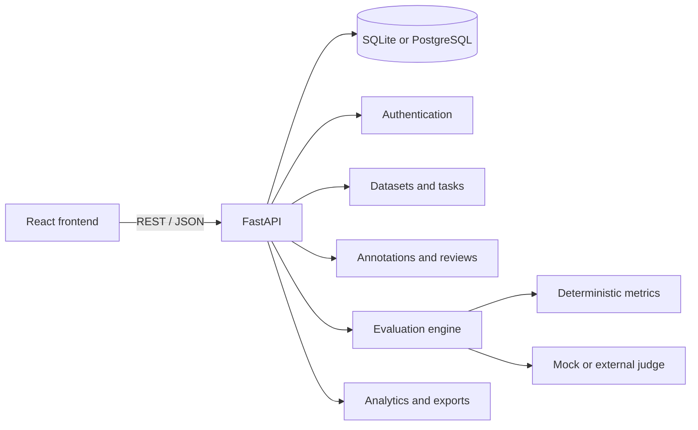
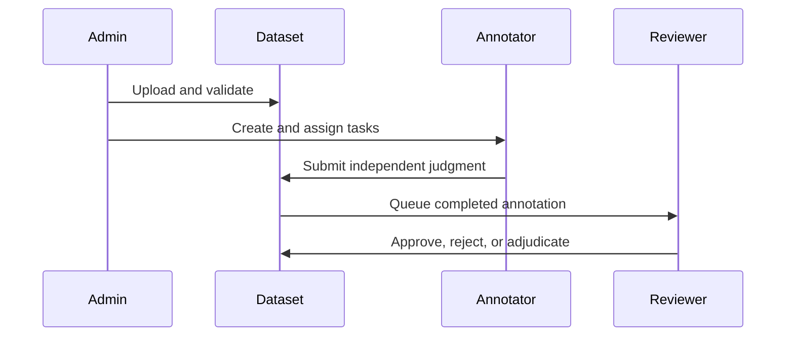

# EvalForge

**A full-stack platform for human and AI-assisted response evaluation**

[](https://www.python.org/)
[](https://fastapi.tiangolo.com/)
[](https://react.dev/)
[](https://www.postgresql.org/)
[](LICENSE)

EvalForge helps teams ingest evaluation datasets, collect independent human judgments, review disagreements, run AI-assisted scoring, and analyze evaluator reliability.

## Features

- Dataset ingestion for CSV, JSON, and JSONL files
- Pairwise comparisons with **A**, **B**, **Tie**, and **Both Poor** outcomes
- Rubric scoring and structured error annotations
- Human annotation, revision, review, and adjudication workflows
- Deterministic metrics, rubric scoring, and LLM judge support
- Agreement, benchmark, error-distribution, and position-bias analytics
- CSV and JSON exports
- Local SQLite and Dockerized PostgreSQL configurations
- Gemini, OpenAI-compatible, and mock LLM providers

## Technology

| Layer | Technology |
|---|---|
| Frontend | React 18, TypeScript, Vite, Recharts |
| Backend | Python 3.11, FastAPI, SQLAlchemy, Pydantic |
| Database | SQLite for local development, PostgreSQL 16 for Docker |
| Authentication | JWT and bcrypt |
| Evaluation | NumPy, pandas, scikit-learn, SciPy |
| Deployment | Docker Compose and Nginx |

## Architecture



For more detail, see [Architecture](docs/architecture.md).

## Quick Start

### Option 1: Docker Compose

The fastest way to run the complete application:

```powershell
docker compose up --build
```

Open:

| Service | URL |
|---|---|
| Frontend | http://localhost:5173 |
| Backend API | http://localhost:8000 |
| API documentation | http://localhost:8000/docs |
| Health check | http://localhost:8000/health |

Stop the stack:

```powershell
docker compose down
```

To stop it and remove the PostgreSQL volume:

```powershell
docker compose down -v
```

> `docker compose down -v` permanently deletes the local database.

### Option 2: Run Locally

#### Prerequisites

- Python 3.11+
- Node.js 20+
- npm

#### Backend

```powershell
cd backend
python -m venv .venv
.\.venv\Scripts\Activate.ps1
python -m pip install --upgrade pip
pip install -r requirements.txt
Copy-Item .env.example .env
uvicorn app.main:app --reload
```

The API is available at http://localhost:8000.

#### Frontend

Open a second terminal:

```powershell
cd frontend
npm install
npm run dev
```

Open http://localhost:5173. Vite proxies `/api` requests to the backend.

## Configuration

Backend settings are read from `backend/.env` during local development.

```env
DATABASE_URL=sqlite:///./evalforge.db
JWT_SECRET=replace-this-with-a-long-random-secret
JWT_ALGORITHM=HS256
ACCESS_TOKEN_MINUTES=720

LLM_PROVIDER=gemini
GEMINI_API_KEY=
GEMINI_MODEL=gemini-2.5-flash

OPENAI_API_KEY=
OPENAI_BASE_URL=https://api.openai.com/v1
OPENAI_MODEL=gpt-4o-mini
```

Copy the checked-in example to create the file:

```powershell
cd backend
Copy-Item .env.example .env
```

### Judge Providers

| Provider | Setting | Notes |
|---|---|---|
| Gemini | `LLM_PROVIDER=gemini` | Default provider; requires `GEMINI_API_KEY` |
| OpenAI-compatible | `LLM_PROVIDER=openai` | Requires an API key and compatible chat endpoint |
| Mock | `LLM_PROVIDER=mock` | Deterministic local response for UI and workflow testing |

Mock results are illustrative and must not be treated as real evaluation results.

### Docker Environment

Create a `.env` file beside `docker-compose.yml`:

```env
JWT_SECRET=replace-this-with-a-long-random-secret
LLM_PROVIDER=gemini
GEMINI_API_KEY=your-api-key
GEMINI_MODEL=gemini-2.5-flash
```

For Docker, the PostgreSQL credentials are fixed in `docker-compose.yml`:

```text
Database: evalforge
User: evalforge
Password: evalforge
Port: 5432
```

Replace these defaults before any public deployment.

## Initial Use

1. Start the backend and frontend.
2. Open Swagger at http://localhost:8000/docs.
3. Register an admin user:

```json
POST /api/auth/register

{
  "email": "admin@example.com",
  "name": "Admin",
  "password": "replace-with-a-strong-password",
  "role": "admin"
}
```

4. Log in and use the returned JWT for protected API requests.
5. Upload [datasets/sample/sample_tasks.json](datasets/sample/sample_tasks.json).
6. Create tasks, assign annotators, and submit judgments.

## API Overview

Interactive documentation is available from Swagger UI and the OpenAPI schema:

- http://localhost:8000/docs
- http://localhost:8000/openapi.json

### Main Route Groups

| Route group | Examples |
|---|---|
| Authentication | `/api/auth/register`, `/api/auth/login`, `/api/auth/me` |
| Datasets | `/api/datasets/upload`, `/api/datasets`, `/api/datasets/{id}` |
| Tasks | `/api/tasks/create`, `/api/tasks/my-tasks`, `/api/tasks/{id}` |
| Annotations | `/api/annotations/submit`, `/api/annotations/task/{task_id}` |
| Reviews | `/api/reviews/pending`, `/api/reviews/approve`, `/api/reviews/adjudicate` |
| Evaluation | `/api/evaluation/single`, `/api/evaluation/pairwise`, `/api/evaluation/batch` |
| Analytics | `/api/analytics/dashboard`, `/api/analytics/agreement`, `/api/analytics/benchmark` |
| Export | `/api/export/annotations/csv`, `/api/export/annotations/json`, `/api/export/benchmark/json` |

## Evaluation Workflow



Recommended practice:

1. Keep annotator judgments independent.
2. Record confidence and rationale.
3. Preserve revision history.
4. Separate individual, majority, and adjudicated labels.
5. Report rubric and judge versions with every benchmark.
6. Test response pairs in both orders to detect position bias.

See [Annotation Guidelines](docs/annotation_guidelines.md) and [Evaluation Protocol](docs/evaluation_protocol.md).

## Project Structure

```text
EvalForge/
├── backend/
│   ├── app/
│   │   ├── analytics/
│   │   ├── api/routes/
│   │   ├── core/
│   │   ├── database/
│   │   ├── evaluation/
│   │   ├── models/
│   │   ├── schemas/
│   │   └── main.py
│   ├── app/tests/
│   ├── Dockerfile
│   └── requirements.txt
├── frontend/
│   ├── src/pages/
│   ├── src/services/
│   ├── src/types/
│   ├── Dockerfile
│   └── nginx.conf
├── datasets/sample/
├── docs/
├── experiments/
├── docker-compose.yml
└── README.md
```

## Testing

### Backend

```powershell
cd backend
pytest
```

The current backend suite covers exact-match and overlap metrics, weighted rubric scoring, and pairwise comparison.

### Frontend

```powershell
cd frontend
npm run build
npm test
```

The build runs TypeScript and Vite compilation. Add `--run` to Vitest if you want a one-time test run instead of watch mode:

```powershell
npm test -- --run
```

## Development Notes

- Database tables are created when the FastAPI application starts.
- The Docker stack uses PostgreSQL; direct local runs use SQLite by default.
- API keys and private datasets should never be committed.
- The frontend currently uses the same API origin for development and Docker deployments.
- Fleiss' Kappa, migrations, complete role enforcement, production audit logging, and background job workers are not complete platform features.

## Security

Before deploying publicly:

- Replace all default JWT and database secrets.
- Restrict CORS origins.
- Enforce authorization on every protected route.
- Use HTTPS and a secrets manager.
- Add rate limiting and monitoring.
- Review dataset licenses and privacy requirements.
- Keep human judgments and raw model outputs separate.

## Documentation

- [Architecture](docs/architecture.md)
- [Annotation Guidelines](docs/annotation_guidelines.md)
- [Evaluation Protocol](docs/evaluation_protocol.md)
- [Research Report](docs/research_report.md)

## License

EvalForge is available under the [MIT License](LICENSE).
